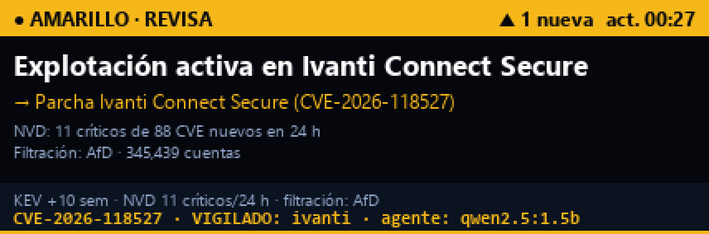

# Badge Agente

Convertí el badge de JSConf México 2026 en un agente local que te avisa de vulnerabilidades. Cada 30 minutos consulta fuentes públicas, un modelo en Ollama redacta el aviso en español y el badge lo muestra en su pantalla.



El proyecto corre en tu computadora. No necesita API keys ni cuentas, y el modelo trabaja en local.

## Cómo funciona

1. **Fuentes públicas:** [CISA KEV](https://www.cisa.gov/known-exploited-vulnerabilities-catalog) (lo que ya se está explotando), [NVD](https://nvd.nist.gov/) (CVE críticos de las últimas 24 h) y [Have I Been Pwned](https://haveibeenpwned.com/) (la filtración más reciente).
2. **Reglas:** deciden el nivel (ROJO, AMARILLO o VERDE) y fijan las cifras.
3. **Ollama:** redacta el titular y la acción en español. Si contesta en inglés, de forma genérica o no responde, se usa un texto por reglas.
4. **Badge por USB:** la imagen se sube a la página Canvas.

La IA redacta, pero no decide el nivel ni inventa cifras.

## Qué incluye

| Archivo | Para qué sirve |
| --- | --- |
| `alertas_badge.py` | El agente: consulta, redacta, dibuja y sube al badge |
| `alertas.html` | Panel web con el aviso, las fuentes y el historial |
| `index.html` | Visor en vivo, mensajes, red, mapa de señal, editor de portada y CTF por radio |
| `escaner_ajolotes.py` | Escucha el juego de la conferencia y avisa cuando oye un ajolote |

## Requisitos

- Badge JSConf México 2026 con su firmware original, conectado por USB
- Python 3.11 o superior
- [Ollama](https://ollama.com/) (opcional: sin él, el aviso se redacta por reglas)
- Chrome o Edge para el panel web (usa Web Serial)

## Instalación

```bash
pip install -r requirements.txt
ollama pull qwen2.5:1.5b
```

## Uso

Busca el puerto de tu badge y arranca el agente. En Windows suele ser `COM15` o similar; en Linux, `/dev/ttyACM0`; en macOS, `/dev/cu.usbmodem...`.

```bash
python alertas_badge.py --port COM15 --every 30 --watch php,ivanti,fortinet
```

| Opción | Qué hace |
| --- | --- |
| `--port` | Puerto serial del badge |
| `--every` | Minutos entre actualizaciones |
| `--watch` | Palabras a resaltar, separadas por comas |
| `--model` | Modelo de Ollama |
| `--once` | Hace una sola actualización |
| `--no-upload` | Genera la imagen y el panel sin subir al badge |
| `--no-agent` | No usa Ollama: redacta por reglas |

Para abrir el panel, en otra terminal:

```bash
python -m http.server 8765 --bind 127.0.0.1
```

- Panel del agente: <http://localhost:8765/alertas.html>
- Visor y herramientas: <http://localhost:8765/>

En el badge, entra a la página **Canvas** para ver el aviso.

Solo un programa puede usar el puerto a la vez: detén el agente antes de conectar el visor web.

## Limitaciones

- El agente vigila listas públicas. No escanea tus sistemas ni sabe qué tienes instalado, salvo por las palabras de `--watch`.
- Si una fuente falla, usa sus últimos datos guardados.
- El límite público del NVD es de 5 peticiones cada 30 s.

## Licencias

- Código: [GPL-3.0](LICENSE).
- `assets/` contiene arte del [kit de JSConf México 2026](https://www.jsconf.mx/en/brandbook), bajo [CC BY-NC-SA 4.0](https://creativecommons.org/licenses/by-nc-sa/4.0/). No permite uso comercial.
- El badge es de [Electronic Cats](https://electroniccats.com) y su firmware está basado en [Meshtastic](https://meshtastic.org). Este proyecto no está afiliado a ninguno de ellos.

Hecho por [@cibergabs](https://github.com/GarciaG1).
